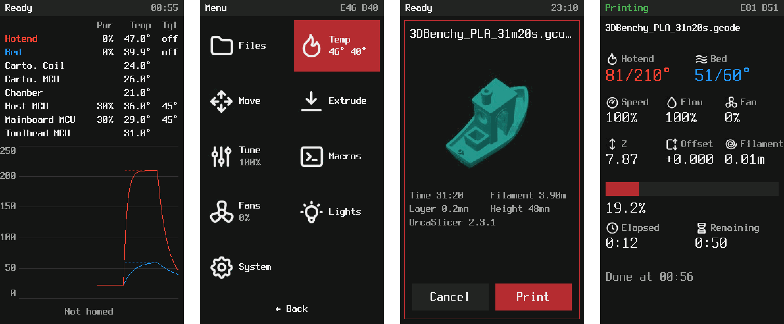
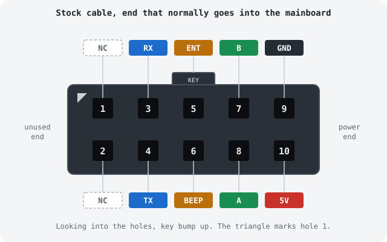

# klipper-dwin-ui

[](https://github.com/andersevenrud/klipper-dwin-ui/actions/workflows/tests.yml)

A KlipperScreen-like interface for the stock **Ender 3 V2 display**, running
against Klipper through Moonraker. The display, knob and beeper work again,
without Marlin and without a Klipper fork.



## Features

- **Home screen**, like Mainsail's dashboard: every temperature sensor
  Klipper knows about, a live hotend/bed graph and the toolhead position.
- **Printing screen** while a job runs: progress, time left, temperatures,
  speed, flow, fan and Z.
- **Menus:**
  - **Print:** browse folders and start a print from a preview with the
    slicer's thumbnail, print time and filament. Recent prints (from
    Moonraker's history) are one press away, and files can be deleted from
    the preview.
  - **Temperature:** set targets, or use a preheat preset.
  - **Move:** homing, and jogging with the knob.
  - **Extrude**, and **Tune:** speed, flow, fan and Z babystepping.
  - **Fans:** set the part fan and any `fan_generic`, and see what the
    automatic fans are doing.
  - **Lights:** dim or switch `output_pin` lights and LEDs. The tile only
    appears when the printer has lights.
  - **Macros**, and **System:** restarts, emergency stop, host power,
    backlight, Moonraker power devices (`[power]`), and a console with
    Klipper's recent messages.
- **When Klipper isn't ready**, the screen shows why and offers what helps:
  restarts, switching on or power-cycling the printer's supply if Moonraker
  controls it, and the console.
- **Knob controls:** turn, press, and hold to go back; see
  [Controls](#controls).
- **Sharper font, icons and a Klipper boot logo**, flashed onto the display
  once from a microSD card.

## What you need

- An Ender 3 V2 display, in the usual DWIN version with a microSD slot on
  the back. Some later units have a TJC clone panel instead; those can't
  take the font and icons, and haven't been tested.
- A Klipper host running Moonraker.
- One of:
  - **A Raspberry Pi Pico**, or any RP2040 board that runs CircuitPython.
    It plugs into the host over USB, so any host works.
  - **The Klipper host's own GPIO header**, if the host is a Raspberry Pi
    3, 4 or Zero 2 W with these pins free.
- Dupont jumper wires.
- A microSD card of any size, to flash the font and icons.

## Wiring

Leave the stock cable plugged into the display and use its other end, the
one that normally goes into the mainboard. Push the dupont pins into its
holes:



| Hole | Signal | Raspberry Pi Pico | Raspberry Pi GPIO |
|---|---|---|---|
| 10 | 5V | VBUS (pin 40) | 5V (pin 4) |
| 9 | GND | GND (pin 38) | GND (pin 6) |
| 3 | RX | GP0 (pin 1) | GPIO14 (pin 8) |
| 4 | TX | GP1 (pin 2) | GPIO15 (pin 10) |
| 8 | A | GP2 (pin 4) | GPIO17 (pin 11) |
| 7 | B | GP3 (pin 5) | GPIO27 (pin 13) |
| 5 | ENT | GP4 (pin 6) | GPIO22 (pin 15) |
| 6 | BEEP | GP5 (pin 7) | GPIO18 (pin 12) |
| 1, 2 | not used | | |

Plugs are easy to read mirrored. Before you power anything, check with a
multimeter that hole 9 connects to the display's `GND` pin and hole 10 to
its `VCC` pin.

## Install

### 1. Install dwinui on the Klipper host

```sh
cd ~ && git clone https://github.com/andersevenrud/klipper-dwin-ui.git
~/klipper-dwin-ui/install/install.sh
```

The installer sets up:
- a virtualenv;
- a config file at `~/printer_data/config/dwinui.conf`, which you can edit
  in Mainsail/Fluidd;
- the `dwinui` service;
- permission for Moonraker to restart the service. Moonraker picks this up
  the next time it restarts; the installer tells you when that's needed.

### 2. Connect the display

Do one of these, matching how you wired the display.

#### Option 1: Raspberry Pi Pico over USB

1. Install [CircuitPython](https://circuitpython.org/board/raspberry_pi_pico/)
   on the Pico (tested with 10.3.1).
2. Copy `firmware/rp2040/boot.py` and `firmware/rp2040/code.py` to the
   `CIRCUITPY` drive.
3. Unplug the Pico, then plug it into the Klipper host. It shows up as
   `/dev/dwin`, which the default config already uses.

#### Option 2: The Raspberry Pi's GPIO header

```sh
~/klipper-dwin-ui/install/setup-pi-gpio.sh
sudo reboot
```

Then set the backend in `dwinui.conf`:

```ini
[display]
backend: pi
beeper_pwm: /sys/class/pwm/pwmchip0
```

### 3. Flash the font, icons and boot logo

This gives you the font, icons and Klipper boot logo you see in the
screenshots. Without it, dwinui uses the display's built-in font and shows
no icons. The pack goes onto the display itself, once, from a microSD card.
Creality's icons stay on the display, so stock firmware still works
afterwards.

> To skip this step, see [Without the asset pack](#without-the-asset-pack).

1. **Download
   [DWIN_SET.zip](https://github.com/andersevenrud/klipper-dwin-ui/releases/download/assets/DWIN_SET.zip)**
   and unzip it.
2. **Prepare a microSD card:**
   - Give it a single FAT32 partition of 8 GB or less, with 4 KB clusters
     (MBR partition table). On a bigger card, leave the rest unpartitioned.
     Larger partitions and bigger clusters are a common reason a flash
     fails.
   - Copy only the `DWIN_SET` folder to the card's root, and put nothing
     else on the card.
3. **Flash it:**
   - With the display unpowered, insert the card into the slot on the back
     of the display.
   - Power up. The screen turns **blue** while flashing, then **orange**
     when done.
   - Power off and remove the card.

### 4. Start it

```sh
sudo systemctl restart dwinui
journalctl -u dwinui -f        # look for "display handshake ok"
```

If the knob turns the wrong way, set `invert_encoder: true` under
`[display]`. Everything else in `dwinui.conf` (preheat presets, dimming,
feed rates) is commented.

Settings you change on the display itself are remembered across restarts.
That covers brightness, the jog step and the extrude length and speed.
They're stored in Moonraker's database and take priority over
`dwinui.conf`. **System → Reset display settings** goes back to the config
file.

### Updates

Add this to `moonraker.conf` to update dwinui from Mainsail/Fluidd:

```ini
[update_manager dwinui]
type: git_repo
path: ~/klipper-dwin-ui
origin: https://github.com/andersevenrud/klipper-dwin-ui.git
primary_branch: main
virtualenv: ~/dwinui-env
requirements: requirements.txt
managed_services: dwinui
```

### Uninstall

```sh
~/klipper-dwin-ui/install/uninstall.sh
```

This removes the service, the udev rule, the Moonraker service entry and
the virtualenv. It leaves your `dwinui.conf`, `moonraker.conf` and the
repository alone, and tells you what's left for you to delete.

## Controls

Everything works with the knob: **turn** it, **press** it, or **hold** it
down for about half a second (600 ms).

| Where | Turn | Press | Hold |
|---|---|---|---|
| Home screen | scroll the sensor list, if it has more sensors than fit | open the menu | — |
| Menu and lists | move the highlight | open or select it | go back |
| Editing a value (orange row) | change it; spin fast for bigger steps | save | cancel without saving |
| Jogging or Z offset (`◀▶` row) | move immediately | done | done |
| Dialogs | choose a button | confirm the choice | close |
| Printing screen | — | open the menu | — |
| After a print | — | return home | — |

- **Holding:** it acts as soon as you've held long enough, so you don't need
  to let go first.
- **Going back without holding:** every list has a **← Back** row, and the
  menu has a **Back** tile.
- **Dimmed display:** after two minutes idle the backlight dims. The next
  turn or press only wakes it up, so nothing gets selected by accident.

You can change these in `dwinui.conf` under `[display]`:
- `long_press_ms`: how long to hold;
- `invert_encoder`: flips the turning direction;
- `dim_timeout`: idle time before dimming, in seconds; `0` turns dimming
  off.

## Font and icon pack

### Without the asset pack

If the display still has its stock files, set this in `dwinui.conf` and
restart dwinui:

```ini
[display]
custom_assets: false
```

dwinui then uses the display's built-in font and shows no icons. Symbols
fall back to plain characters: `←` becomes `<` and `°` a space.
Without this setting, those symbols show up as unrelated stock glyphs, and
icons may come out as garbage.

### Going back to stock

Flash the
[stock files](https://github.com/mriscoc/Ender3V2S1/tree/Ender3V2S1-Bugfix/display%20assets/stock)
the same way, then set `custom_assets: false`. Your printer's original
firmware works either way, because the pack leaves Creality's icons in
place.

### Building the pack yourself

In a clone of this repo, on any computer with Python 3.11 or newer:

```sh
pip install -e '.[sim]'
python tools/build_assets.py      # -> build/DWIN_SET
```

The script downloads the font and icon sources and checks them against
fixed checksums. The GitHub Action runs the same script to make the
download.

## More

[docs/technical.md](docs/technical.md) covers:
- the display protocol and the bridge protocol;
- the full connector pinout and where it comes from;
- the asset pack format;
- the architecture;
- the simulator, which lets you try the UI in a browser without hardware.

## License

MIT, see [LICENSE](LICENSE).

The asset pack is built from third-party work that isn't stored in this
repository; `tools/build_assets.py` downloads it:
- [Terminus Font](https://terminus-font.sourceforge.net/) (SIL Open Font
  License 1.1);
- [Tabler Icons](https://tabler.io/icons) (MIT);
- the [Klipper](https://github.com/Klipper3d/klipper) logo, used for the
  boot splash.

The print preview screenshot shows
[#3DBenchy](https://www.3dbenchy.com/) by Creative Tools (CC BY-ND 4.0).
